# Artificiële Intelligentie

## Artificiële Intelligentie

Waar denk jij aan bij de term Artificiële Intelligentie?

:::: {.columns}
::: {.column width="72%"}
::: {.block}
::: {.block-title}
Wooclap
:::
Noem *één ding* dat jij deze week gebruikt hebt waar volgens jou AI in zit.
:::

Scan de QR-code of surf naar [app.wooclap.com/RQJOAID](https://app.wooclap.com/RQJOAID)
:::
::: {.column width="28%"}
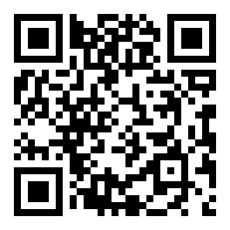{width="280"}
:::
::::

::: {.notes}
- Laat de woordwolk 1-2 minuten vollopen, bespreek daarna de grootste woorden.
- Doorvraag bij een paar antwoorden: "Waarom denk je dat daar AI in zit? Wat doet
  het dat 'slim' is?" Kies bewust ook een twijfelgeval (bv. rekenmachine,
  Google Maps, autocorrectie): is dat intelligent, of volgt het gewoon regels?
- Dat verschil (vaste regels vs. zelf leren uit voorbeelden) is de brug naar de
  volgende slide "Wat is Artificiële Intelligentie?".
:::

## Wat is Artificiële Intelligentie?

:::: {.columns}
::: {.column width="50%"}
[Artificieel]{.highlight}

- Niet op een natuurlijke manier
- Kunstmatig
:::
::: {.column width="50%"}
[Intelligentie]{.highlight}

- Relatief moeilijk te definiëren.
- Veel verschillende definities.
- Filosofen vs. psychologen
:::
::::

## Gangbare praktische definitie

::: {.block}
[Definitie AI-systeem]{.block-title}

Een AI-systeem is een *computersysteem* dat *zelfstandig leert*, *beslissingen neemt*
en *deze uitvoert*.
:::

Bron: boek "Mens vs. Machine" door Geertrui Mieke de Ketelaere.

## Onderdelen van AI

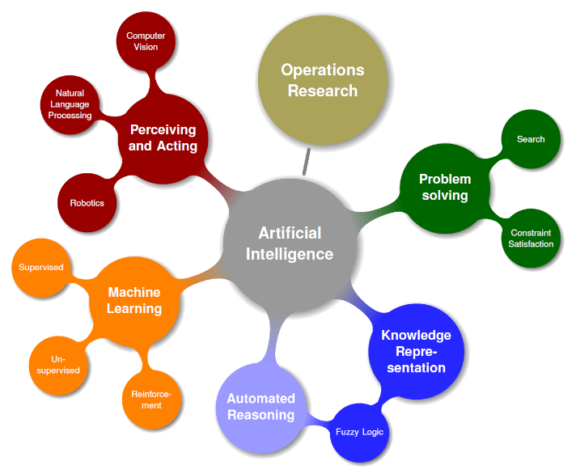{fig-align="center" width="60%"}

[Bron: <https://www.researchgate.net/figure/Different-Areas-Under-Artificial-Intelligence-2_fig1_343079524>]{.bron}

# Traditioneel Programmeren?

## Traditioneel Programmeren?

Schrijven van een **spam filter**.

- Hoe ziet spam er typisch uit?
  - ["4U", "free", "credit card", VEEL HOOFDLETTERS]{.fragment fragment-index=1}
- [Schrijf een algoritme om de patronen hierboven te detecteren.]{.fragment fragment-index=1}
- [Test programma en herhaal stappen 1 en 2.]{.fragment fragment-index=1}

## Mogelijke Code

```python
def is_spam(email):
    if heeft_veel_hoofdletters(email):
        return True
    if aantal_voorkomens(email, "credit card") > 2:
        if header(email) != "Mijn bank":
            return True
    if aantal_spellingsfouten(email) > 10:
        if afzender(email) != "Mijn vriend":
            return True
        else:
            return False
    # Nog heel veel andere regels
    return False
```

## Problemen met deze Aanpak?

. . .

- De lijst met regels wordt snel heel lang en complex; je zal veel pogingen nodig hebben om de lijst op punt te stellen.
- Wat als de spammers doorkrijgen hoe jouw lijst werkt?
  - Dan kan je herbeginnen!

# Machinaal Leren

## Wat is Machinaal Leren?

::: {.block}
[Machinaal Leren]{.block-title}

*Machinaal Leren* is de wetenschap (en kunst) om computers te programmeren zodanig dat ze kunnen *leren van data*.
(Hands-on Machine Learning with Scikit-Learn, Keras and Tensorflow door Aurélien Géron.)
:::

::: {.block}
[Machinaal Leren]{.block-title}

*Machinaal Leren* is het studiegebied dat computers de mogelijkheid geeft om te leren zonder *expliciet* geprogrammeerd te zijn.
(Arthur Samuel, 1959)
:::

## Toepassingen van ML

Welke toepassingen van machinaal leren ken jij?

. . .

- Spamdetectie
- Classificatie van beelden
- Fraudedetectie bij creditkaarten
- Aanbevelingssystemen (recommendation systems)
- Spraakherkenning (bv. Siri, Alexa, …)
- Genereren van teksten, beelden (bv. ChatGPT, MidJourney)
- …

## Voorbeelden

:::: {.columns}
::: {.column width="50%"}
{width="90%"}
:::
::: {.column width="50%"}
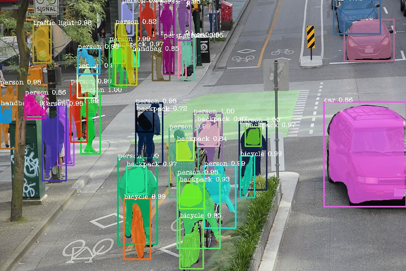{width="90%"}
:::
::::

[Bronnen: <https://emerj.com/ai-sector-overviews/artificial-intelligence-at-amazon/> en <https://towardsdatascience.com/image-segmentation-with-six-lines-0f-code-acb870a462e8>]{.bron}

## Verschillende Soorten ML

- **Gesuperviseerd** leren. (Eng. supervised learning)
  - Gegeven veel gelabelde voorbeelden (bv. emails met label spam/ham) bepaal het label voor een nieuw voorbeeld.
- **Ongesuperviseerd** leren. (Eng. unsupervised learning)
  - Ontdek structuur in ongelabelde data. (bv. clustering)
- **Reinforcement** learning.
  - Leer een beleid (Eng. policy) dat de grootste beloning op lange termijn oplevert.
    Zie bv. <https://www.youtube.com/watch?v=V1eYniJ0Rnk>

## Soorten ML

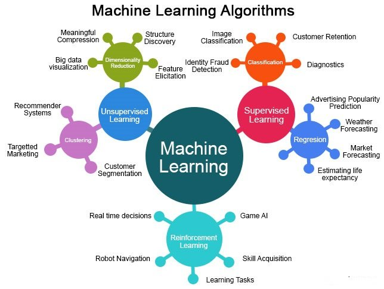{fig-align="center" width="60%"}

[Bron: <https://www.researchgate.net/figure/Categorization-of-Machine-Learning-5_fig4_343079524>]{.bron}

# Lineaire Regressie

## Notebook Lineaire Regressie

Open de Jupyter notebook `LineaireRegressie.ipynb` op Google Colab
(<https://colab.research.google.com>).

Deze notebook is beschikbaar op <https://github.com/HoGentTIN/ml-workshop-middelbaar>

## Lineaire Regressie

Samenvatting notebook `LineaireRegressie.ipynb`.

- Definieer een model met **parameters**: $a$ en $b$ in dit geval.
- Definieer een **kostfunctie** die de kwaliteit van de parameters aangeeft (kleiner is beter).
- Minimaliseer deze kostfunctie m.b.v. **gradient descent**: dit geeft je dan de beste parameters voor jouw model.

## Conclusie Lineaire Regressie

::: {.block}
[Conclusie]{.block-title}

De drie voorgaande stappen:

- Model
- Kostfunctie
- Optimalisatie m.b.v. gradient descent

zijn de basisstappen voor heel veel modellen van gesuperviseerd leren.
:::

Echter! Nog veel andere technieken nodig om dit praktisch te laten werken op ingewikkelde problemen.

# Neurale Netwerken

## (Binaire) classificatie

- Bij **binaire classificatie** tracht men de invoer te classificeren als 1 van 2 mogelijke klassen.
- Bv. spam of ham, kat of hond, of … <https://www.youtube.com/watch?v=tWwCK95X6go>
- Bij **classificatie** zijn er meerdere klassen, bv. E-mails worden in verschillende
  folders geclassificeerd: "Primary", "Social", "Reclame".

## Neurale netwerken

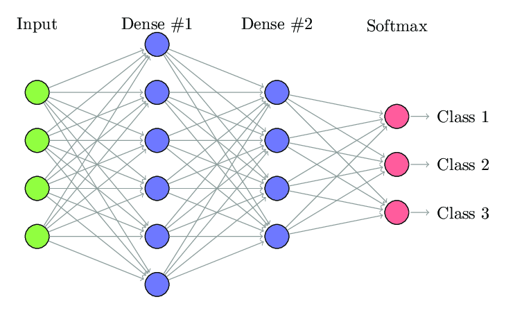{fig-align="center" width="80%"}

[Bron: <https://www.researchgate.net/figure/Example-of-fully-connected-neural-network_fig2_331525817>]{.bron}

## Neurale netwerken

- Een neuraal netwerk bestaat uit een groot aantal **neuronen**.
  - Elk neuron doet een **heel eenvoudige berekening**: nl. een gewogen gemiddelde
    van de invoer gevolgd door een activatiefunctie.
- De uitvoer van een neuron wordt de invoer voor andere neuronen.
- Neuronen worden typisch georganiseerd in **lagen**.
  - Als er veel lagen zijn: een "diep" neuraal netwerk $\implies$ "deep learning".
- De parameters van het model zijn de sterktes van de verbindingen tussen de neuronen.
  - Deze parameters worden aangepast tijdens het trainen van het neuraal netwerk.

## Tensorflow Playground

Ga naar <https://playground.tensorflow.org/>.

Doe de opdracht die hier beschreven staat: <https://developers.google.com/machine-learning/crash-course/introduction-to-neural-networks/playground-exercises>

# Beeldverwerking

## Computerafbeeldingen?

Een computer "ziet" een foto/afbeelding eigenlijk als niets anders dan een raster van getallen.

- Getallen zijn vaak gehele getallen tussen 0 en 255.
- Voor een zwart/wit foto is er één getal per pixel.
- Voor een kleurenfoto zijn er drie waarden per pixel, één voor het kanaal "Rood", één voor het kanaal "Groen" en
  één voor het kanaal "Blauw". Zie: <https://www.youtube.com/watch?v=UBX2QQHlQ_I&t=118s>.

## Voorbeeldafbeelding

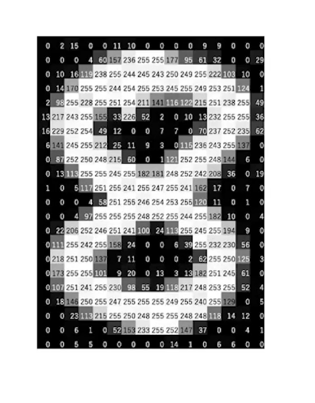{fig-align="center" width="40%"}

## ImageNet Competitie

- ImageNet bestaat uit een groot aantal afbeeldingen (meer dan 1.000.000) onderverdeeld in 1000 klassen.
- Gebruikt als een prestigieuze competitie om "computer vision" mogelijkheden te evalueren.

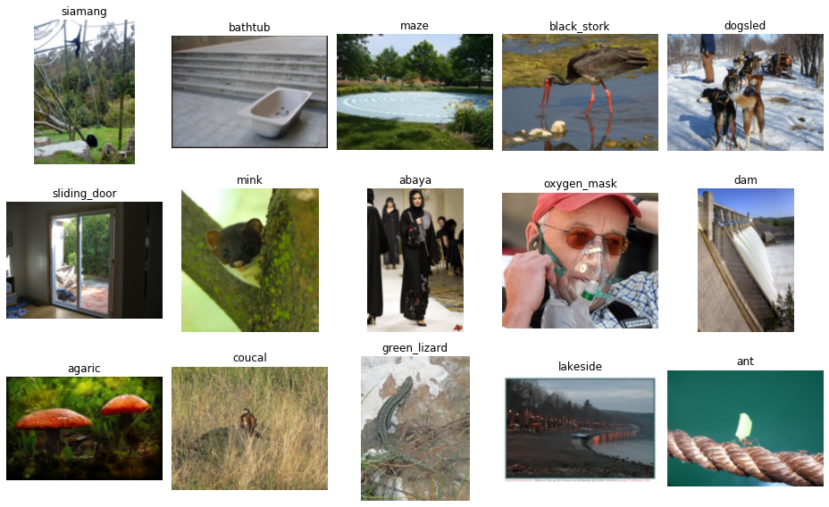{fig-align="center" width="50%"}

## AlexNet

- Alex Krizhevsky nam in 2012 samen met Ilya Sutskever en Geoffrey Hinton deel aan de ImageNet competitie met een convolutioneel neuraal netwerk.
- Hij won, en hoe! Zijn model had "top five error rate" van 16 procent, het model
  op de tweede plaats haalde 26 procent.

# Convolutionele Neurale Netwerken

## Waarom geen gewoon neuraal netwerk?

- Een kleurenfoto van $100 \times 100$ pixels bestaat uit $100 \times 100 \times 3 = 30\,000$ getallen.
- Eén volledig geconnecteerde laag met 128 neuronen: elk neuron is verbonden met **elke** pixel
  $\implies$ bijna **4 miljoen** gewichten!
- Schuift de hand een paar pixels op, dan krijgt het netwerk een totaal andere invoer.

::: {.block}
[Idee van een CNN]{.block-title}

Zoek met een **klein venstertje** (filter) naar eenvoudige patronen zoals randen en hoeken,
en doe dat **overal** in de afbeelding met **hetzelfde** filter.
Diepere lagen combineren die patronen tot steeds complexere vormen: vingers, een vuist, een gezicht, ...
:::

## CNN Explainer

We bekijken een klein CNN (*Tiny VGG*) met de interactieve visualisatie **CNN Explainer**:
<https://poloclub.github.io/cnn-explainer/>

- Het netwerk herkent 10 klassen: lieveheersbeestje, pizza, koala, espresso, schoolbus, ...
- Invoer: een kleurenafbeelding van $64 \times 64$ pixels.
- Je kan op **elke laag** en **elk neuron** klikken om te zien wat er gebeurt.

```{mermaid}
%%| fig-width: 14
flowchart LR
  I["Input<br/>64×64×3"] --> C1["Conv + ReLU<br/>10 filters"] --> C2["Conv + ReLU<br/>10 filters"] --> P1["Max<br/>Pool"]
  P1 --> C3["Conv + ReLU<br/>10 filters"] --> C4["Conv + ReLU<br/>10 filters"] --> P2["Max<br/>Pool"]
  P2 --> F["Flatten"] --> S["Softmax<br/>10 klassen"]
```

## CNN Explainer: live {background-iframe="https://poloclub.github.io/cnn-explainer/" background-interactive="true"}

::: {.notes}
Laat de leerlingen eerst vrij rondklikken. Wijs op de kleuren: rood/blauw = activaties, de lijnen = verbindingen (kernels).
Kies bovenaan een andere afbeelding en laat zien dat de uitvoerkansen veranderen.
:::

## 1. De invoerlaag

:::: {.columns}
::: {.column width="55%"}
- Een kleurenafbeelding bestaat uit **3 kanalen**: rood, groen en blauw.
- Elk kanaal is een raster van getallen.
- We **normaliseren** de getallen van 0–255 naar 0–1.
- In CNN Explainer: $64 \times 64 \times 3$.\
  In onze notebook: $100 \times 100 \times 3$.
:::
::: {.column width="45%"}
::: {.block}
[🔍 Probeer in CNN Explainer]{.block-title}

Klik op de drie kanalen van de **input**-laag (helemaal links).
Welk kanaal is het lichtst voor een rode paprika?

[Uitleg: input layer](https://poloclub.github.io/cnn-explainer/#article-input)
:::
:::
::::

## 2. De convolutielaag

Een convolutie schuift een klein venster (bv. $3\times 3$) over de afbeelding.
De overlappende getallen worden twee aan twee vermenigvuldigd en opgeteld $\implies$ één nieuwe "pixel".

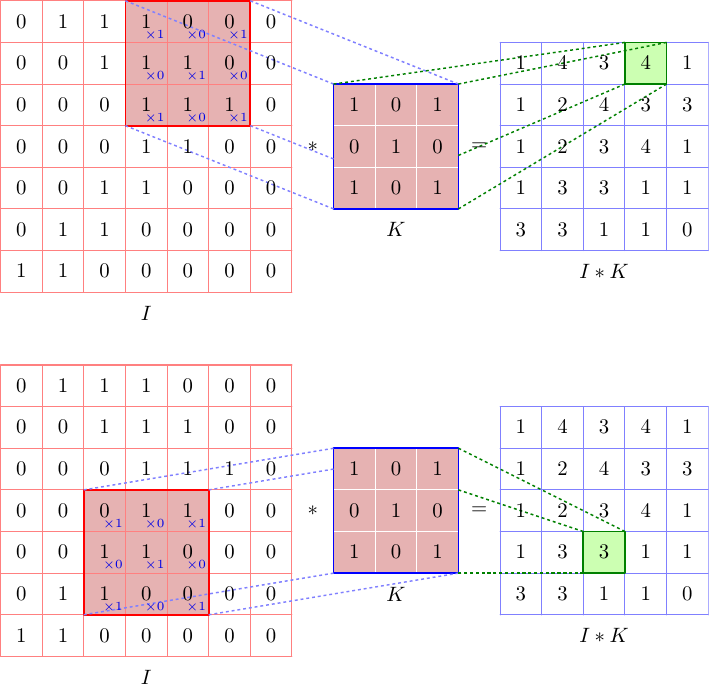{fig-align="center" width="38%"}

## 2. De convolutielaag: in CNN Explainer

:::: {.columns}
::: {.column width="55%"}
- Eén filter levert één nieuwe afbeelding op: een **feature map** (activation map).
- Een laag heeft **veel** filters $\implies$ evenveel feature maps.
- Bij een kleurenafbeelding heeft elk filter een $3\times 3$-venster **per kanaal**: de resultaten
  worden opgeteld, samen met een **bias**.
:::
::: {.column width="45%"}
::: {.block}
[🔍 Probeer in CNN Explainer]{.block-title}

Klik op de bovenste feature map van `conv_1_1`.
Bekijk de animatie: hoeveel verschillende $3 \times 3$-filters worden er gebruikt? Waarom precies zoveel?

[Uitleg: convolutional layers](https://poloclub.github.io/cnn-explainer/#article-convolution)
:::
:::
::::

## 2. Convoluties: leren

- Convoluties zijn niet nieuw: ze werden lang voor deep learning al gebruikt in beeldverwerking.
- Traditioneel werden de getallen in het venster **met de hand** bepaald, bv. om horizontale of verticale randen te detecteren.
- In een CNN zijn de getallen in de vensters **parameters** van het model, die geleerd worden tijdens het trainen.
  (Net zoals de parameters $a$ en $b$ bij lineaire regressie.)
- 3D-animatie van convoluties: <https://animatedai.github.io/>

## 2. Hyperparameters van een convolutie {.smaller}

Keuzes die **jij** als ontwerper maakt (en die dus niet geleerd worden):

| Hyperparameter | Betekenis | In Keras |
|---|---|---|
| **Kernel size** | grootte van het venster | `Conv2D(32, 3)` $\implies 3 \times 3$ |
| **Aantal filters** | hoeveel feature maps de laag maakt | `Conv2D(32, 3)` $\implies$ 32 |
| **Stride** | met hoeveel pixels het venster telkens opschuift | `strides=1` |
| **Padding** | randje nullen rond de afbeelding zodat ze niet krimpt | `padding="same"` |

::: {.block}
[🔍 Probeer in CNN Explainer]{.block-title}

Scroll naar *Understanding Hyperparameters* en verander padding, kernel size en stride.
Wat gebeurt er met de grootte van de uitvoer?
[Uitleg: hyperparameters](https://poloclub.github.io/cnn-explainer/#article-convolution)
:::

## 3. ReLU-activatie

:::: {.columns}
::: {.column width="55%"}
- Na elke convolutie worden alle **negatieve** waarden op **nul** gezet; positieve waarden blijven behouden.
- $\text{ReLU}(x) = \max(0, x)$: *Rectified Linear Unit*.
- Zonder zo'n niet-lineaire functie zouden alle lagen samen niet meer kunnen dan één enkele laag.
- In Keras: `Conv2D(16, 3, activation="relu")`
:::
::: {.column width="45%"}
::: {.block}
[🔍 Probeer in CNN Explainer]{.block-title}

Klik op een neuron in `relu_1_1`. Vergelijk de feature map vóór en na ReLU: wat is er verdwenen?

[Uitleg: ReLU](https://poloclub.github.io/cnn-explainer/#article-relu)
:::
:::
::::

## 4. Max pooling

:::: {.columns}
::: {.column width="55%"}
- Neem van elk blokje van $2 \times 2$ pixels enkel de **grootste** waarde.
- Breedte en hoogte worden **gehalveerd** $\implies$ 75% van de waarden verdwijnt.
- Gevolgen:
  - veel minder rekenwerk en parameters;
  - het netwerk wordt minder gevoelig voor kleine verschuivingen.
- In Keras: `MaxPooling2D()`
:::
::: {.column width="45%"}
::: {.block}
[🔍 Probeer in CNN Explainer]{.block-title}

Klik op een neuron in `max_pool_1`. Hoe groot is de feature map vóór en na het poolen?

[Uitleg: pooling layers](https://poloclub.github.io/cnn-explainer/#article-pooling)
:::
:::
::::

## 5. Flatten

:::: {.columns}
::: {.column width="55%"}
- De convolutie- en poolinglagen hebben de **kenmerken** uit de afbeelding gehaald.
- Om te **beslissen** welke klasse het is, leggen we alle getallen achter elkaar in één lange rij.
- Bv. $5 \times 5 \times 2 \implies$ een rij van 50 getallen.
- In Keras: `Flatten()`
:::
::: {.column width="45%"}
::: {.block}
[🔍 Probeer in CNN Explainer]{.block-title}

Klik op een van de uitvoerklassen (rechts). Volg de lijnen terug: waar komen de getallen vandaan?

[Uitleg: flatten layer](https://poloclub.github.io/cnn-explainer/#article-flatten)
:::
:::
::::

## 6. Uitvoer: Dense + Softmax

:::: {.columns}
::: {.column width="55%"}
- Eén neuron **per klasse**: Tiny VGG heeft er 10, onze steen-papier-schaar-CNN 3.
- **Softmax** zet de uitkomsten om naar **kansen** tussen 0 en 1, die samen 100% zijn.
- De klasse met de hoogste kans is de voorspelling.
- In Keras: `Dense(3, activation="softmax")`
:::
::: {.column width="45%"}
::: {.block}
[🔍 Probeer in CNN Explainer]{.block-title}

Klik op de uitvoerlaag en speel met de formule van softmax.
Kies bovenaan een andere afbeelding: wanneer is het netwerk twijfelachtig?

[Uitleg: softmax](https://poloclub.github.io/cnn-explainer/#article-softmax)
:::
:::
::::

# Zelf een CNN bouwen

## ENNUI: een CNN in elkaar slepen

Ga naar <https://math.mit.edu/ennui/> en klik op **Start Building**.

- Je bouwt een neuraal netwerk door **lagen te slepen** en ze met elkaar te **verbinden**.
- Het netwerk traint **in je browser** op **MNIST**: 70 000 handgeschreven cijfers van $28 \times 28$ pixels.
- Daarna exporteer je het netwerk naar **Python**-code.

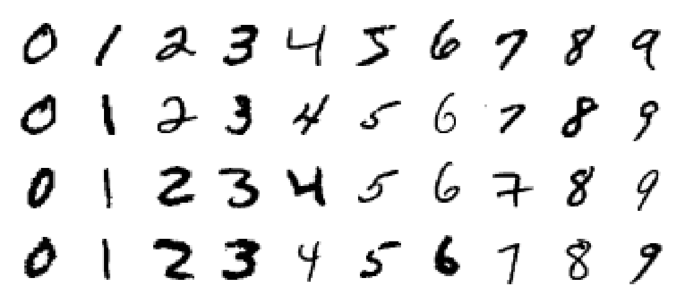{fig-align="center" width="55%"}

## ENNUI: hoe werkt het?

:::: {.columns}
::: {.column width="50%"}
- **Layers** (links): sleep een laag op het canvas.
- **Activations**: sleep `ReLU` óp een laag.
- Verbind de lagen van **Input** tot **Output**.
- Klik op een laag om de parameters te wijzigen (aantal filters, kernel size, ...).
:::
::: {.column width="50%"}
- **Parameters** (rechts): kies de dataset **MNIST** en zet **Epochs** op **3**.
- Klik op **Train** en volg de accuracy bij **Model Status**.
- Via de icoontjes links zie je de grafieken van het trainen.
:::
::::

::: {.block}
[Ingebouwde uitleg]{.block-title}

Klik bij het opstarten op **Explore Deep Learning** voor een korte rondleiding.
:::

## Opdracht 1: een gewoon neuraal netwerk

Kies **Templates → Blank** en bouw:

```{mermaid}
flowchart LR
  I["Input<br/>28×28×1"] --> F["Flatten"] --> D["Dense 64<br/>+ ReLU"] --> O["Output<br/>10 klassen"]
```

- Train het netwerk en **noteer de accuracy**.
- Hoeveel parameters (gewichten) heeft de `Dense`-laag? ($28 \cdot 28 \cdot 64 + 64$)

## Opdracht 2: een CNN

Kies opnieuw **Templates → Blank** en bouw:

```{mermaid}
flowchart LR
  I["Input<br/>28×28×1"] --> C1["Convolution 16<br/>+ ReLU"] --> P1["Max<br/>Pooling"] --> C2["Convolution 32<br/>+ ReLU"] --> P2["Max<br/>Pooling"] --> F["Flatten"] --> D["Dense 64<br/>+ ReLU"] --> O["Output<br/>10 klassen"]
```

- Train het netwerk. Is de accuracy beter dan bij opdracht 1?
- Experimenteer: meer filters, een extra `Convolution`-laag, `Dropout`, een andere optimizer (bv. `adam`), ...

## Opdracht 3: exporteren naar Python

1. Klik rechts op **Export to Python** en kopieer de code.
2. Open de notebook `CNN_MNIST.ipynb` in Google Colab:
   [👉 Open in Colab](https://colab.research.google.com/github/HoGentTIN/ml-workshop-middelbaar-2627/blob/main/notebooks/CNN_MNIST.ipynb)
3. Plak de code in de eerste codecel en voer ze uit.

::: {.block}
[🐞 Foutmelding?]{.block-title}

`ValueError: Argument(s) not recognized: {'lr': 0.01}`\
ENNUI gebruikt een oudere versie van Keras. Vervang `lr=` door `learning_rate=`.
:::

## Van ENNUI naar Keras

| ENNUI | Keras |
|---|---|
| Input | `keras.Input(shape=(28, 28, 1))` |
| Convolution + ReLU | `layers.Conv2D(16, 3, activation="relu", padding="same")` |
| Max Pooling | `layers.MaxPooling2D()` |
| Flatten | `layers.Flatten()` |
| Dense + ReLU | `layers.Dense(64, activation="relu")` |
| Output | `layers.Dense(10, activation="softmax")` |

In de notebook bouw je hetzelfde netwerk opnieuw op, maar dan leesbaarder, met `keras.Sequential`.

## Van cijfers naar steen, papier, schaar

| | MNIST | Steen, papier, schaar |
|---|---|---|
| Afbeeldingen | $28 \times 28$, **zwart-wit** | $100 \times 100$, **kleur** |
| Input | `keras.Input(shape=(28, 28, 1))` | `keras.Input(shape=(100, 100, 3))` |
| Aantal klassen | 10 | 3 |
| Uitvoerlaag | `layers.Dense(10, activation="softmax")` | `layers.Dense(3, activation="softmax")` |
| Aantal afbeeldingen | 70 000 | 2 892 $\implies$ gevaar voor **overfitting** |

## Ons CNN voor steen, papier, schaar

```{mermaid}
%%| fig-width: 15
flowchart LR
  I["Input<br/>100×100×3"] --> C1["Conv 16<br/>+ ReLU"] --> P1["Max<br/>Pool"] --> C2["Conv 32<br/>+ ReLU"] --> P2["Max<br/>Pool"] --> C3["Conv 64<br/>+ ReLU"] --> P3["Max<br/>Pool"]
  P3 --> F["Flatten"] --> D["Dense 64<br/>+ ReLU"] --> S["Dense 3<br/>Softmax"]
```

```{.python}
cnn = keras.Sequential([
    keras.Input(shape=(100, 100, 3)),
    # kenmerken zoeken
    layers.Conv2D(16, 3, activation="relu"), layers.MaxPooling2D(),
    layers.Conv2D(32, 3, activation="relu"), layers.MaxPooling2D(),
    layers.Conv2D(64, 3, activation="relu"), layers.MaxPooling2D(),
    # beslissen
    layers.Flatten(),
    layers.Dense(64, activation="relu"),
    layers.Dense(3, activation="softmax"),
])
```

## Notebook: Steen, Papier, Schaar ✊✋✌️

Open de notebook `CNN_SteenPapierSchaar.ipynb` op Google Colab:
[👉 Open in Colab](https://colab.research.google.com/github/HoGentTIN/ml-workshop-middelbaar-2627/blob/main/notebooks/CNN_SteenPapierSchaar.ipynb)

Zet eerst een GPU aan: **Runtime → Runtimetype wijzigen → T4 GPU**.

| Deel | Onderwerp | Bouwsteen |
|---|---|---|
| A | Data bekijken & normaliseren | 1. Input |
| B | Zelf een filter uitproberen | 2. Convolutie |
| C | Gewoon neuraal netwerk als vergelijking | |
| D | Zelf een CNN bouwen en trainen | 2 – 6 |
| E | Evalueren: accuracy & confusion matrix | |
| F | Feature maps bekijken | 2. Convolutie |
| G | Uitdaging: beter model & je eigen hand | |

Vul telkens de cellen met `# TODO` aan.

## Conclusie Steen, Papier, Schaar

- Een CNN haalt een veel betere accuracy dan een gewoon neuraal netwerk, met **minder** parameters.
  - Bv. gewoon netwerk: ±67% met 3,8 miljoen parameters; CNN: ±85% met 430 000 parameters.
- **Overfitting**: bijna 100% op de trainingsset, minder op de testset.
  - Oplossingen: data-augmentatie (spiegelen, draaien, zoomen) en dropout $\implies$ ±95%.
- De eerste lagen leren zelf **randdetectoren**, net zoals de filters die je zelf maakte.
- Een model is maar zo goed als zijn data: getraind op computergegenereerde handen
  $\implies$ moeite met echte foto's.

## Bonus: Schaakstukken herkennen ♟️

Open de notebook `CNN_Schaakstukken.ipynb`:
[👉 Open in Colab](https://colab.research.google.com/github/HoGentTIN/ml-workshop-middelbaar-2627/blob/main/notebooks/CNN_Schaakstukken.ipynb)

- Een schaakbord = $8 \times 8 = 64$ kleine afbeeldingen.
- Je bouwt zelf een CNN dat elk vakje herkent: leeg, of één van de 12 stukken.
- Daarna "leest" je model een volledig bord en schrijft het de stelling uit in **FEN**-notatie.

## AlexNet: Architectuur {visibility="hidden"}

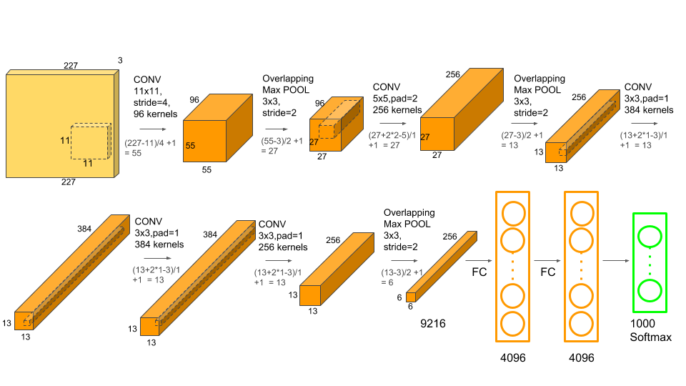{fig-align="center" width="80%"}

## Algemene Architectuur NN {visibility="hidden"}

::: {.block}
[Architectuur Neuraal Netwerk]{.block-title}

Een neuraal netwerk

- Bestaat uit een (groot) aantal lagen.
- Elke laag voert een relatief eenvoudige bewerking uit.
- Samen vormen de lagen een (ingewikkelde) wiskundige functie die invoer
  op uitvoer afbeeldt.
:::

De parameters van het neuraal netwerk worden getraind met (een variant van) gradient descent
om de "optimale" waarden van de parameters te bekomen.

## Tensorflow/Keras {visibility="hidden"}

- Tensorflow en Keras zijn softwarebibliotheken die het mogelijk maken om zeer krachtige
  Deep Learning modellen en applicaties te ontwikkelen op een zeer efficiënte manier.
- Op de volgende slide definiëren en trainen we AlexNet op één enkele slide!
  - In 2012 was dit baanbrekend onderzoek en nu beschikbaar voor iedereen.

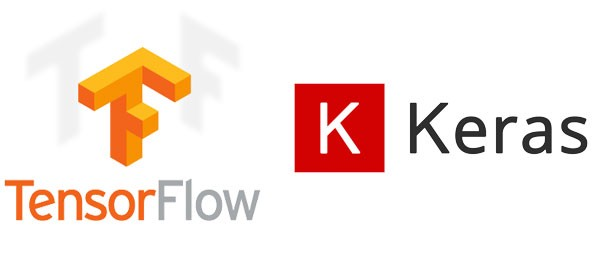{fig-align="center" width="50%"}

## AlexNet in Keras {visibility="hidden"}

```{.python style="font-size: 0.6em"}
# Definieer model
model=keras.models.Sequential([
    keras.layers.Conv2D(filters=96, kernel_size=(11,11), strides=(4,4), activation='relu', padding='valid', input_shape=(227,227,3)),
    keras.layers.MaxPool2D(kernel_size=(3,3), pool_size=(2,2), padding='valid'),
    keras.layers.Conv2D(filters=256, kernel_size=(5,5), strides=(1,1), activation='relu', padding="same"),
    keras.layers.MaxPool2D(kernel_size=(3,3), pool_size=(2,2), padding='valid'),
    keras.layers.Conv2D(filters=384, kernel_size=(3,3), strides=(1,1), activation='relu', padding="same"),
    keras.layers.Conv2D(filters=384, kernel_size=(3,3), strides=(1,1), activation='relu', padding="same"),
    keras.layers.Conv2D(filters=256, kernel_size=(3,3), strides=(1,1), activation='relu', padding="same"),
    keras.layers.MaxPool2D(kernel_size=(3,3), pool_size=(2,2), padding='valid'),
    keras.layers.Flatten(),
    keras.layers.Dense(4096,activation='relu'),
    keras.layers.Dense(4096,activation='relu'),
    keras.layers.Dense(1000,activation='softmax')
])
# Specifieer opties om te trainen
model.compile(
    loss='sparse_categorical_crossentropy',
    optimizer=tf.optimizers.SGD(lr=0.001),
    metrics=['accuracy']
)
# Train het model
history=model.fit(train_ds, epochs=50, validation_data=test_ds)
```

## Transfer Learning {visibility="hidden"}

Het kan nog gemakkelijker dan het zelf implementeren van AlexNet.

- Het blijkt dat de eerste lagen van een convolutioneel neuraal netwerk (zoals AlexNet) dingen leren
  die nuttig zijn voor *alle soorten van classificatietaken* voor beelden.
  - De eerste lagen herkennen zaken als randen, hoeken, cirkels, etc.
  - Hogere lagen combineren deze in zaken als 'gezicht': (twee cirkels op bepaalde plaats, twee horizontale randen (lippen), )
- Hoe verder men komt in de lagen, hoe meer specifiek die zijn voor de taak waarvoor het netwerk getraind is.

## Transfer Learning Visueel {visibility="hidden"}

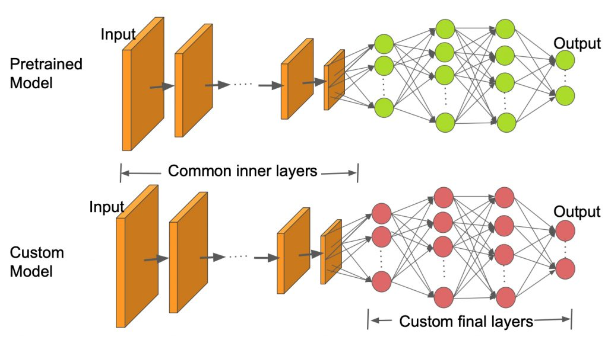{fig-align="center" width="80%"}

## Notebook Transfer Learning {visibility="hidden"}

Open de notebook `WorkshopML_TransferLearning` om transfer learning in actie te zien
om honden en katten van elkaar te kunnen onderscheiden.

## Trainen van een ML model zonder code {visibility="hidden"}

- We gebruiken de `AutoTrain`-feature van Hugging Face om een hond-vs-kat classificatiemodel
  te maken.
- Dit classificatiemodel kan dan aangesproken worden over het Internet.
- Merk op: dit model werd (hoogstwaarschijnlijk) getraind via **transfer learning**.

## Trainen van een ML model zonder code

- We gebruiken Google Teachable Machine om een classificatiemodel aan te maken.
- Dit classificatiemodel kan dan aangesproken worden in een Python notebook.
- Merk op: dit model werd (hoogstwaarschijnlijk) getraind via **transfer learning**.

## Transfer Learning

- Bij **transfer learning** wordt een bestaand model hergebruikt voor een gelijkaardige (maar verschillende taak).
- Bv. voor de classificatie van honden vs. katten kunnen we gebruikmaken van een netwerk
  dat werd getraind op ImageNet, en dat dus 1000 verschillende klassen kan herkennen.
  - De laatste laag van dit model bestaat uit 1000 neuronen.
- We vervangen de laatste (en meest specifieke) laag door een nieuwe laag (met twee neuronen)
  die honden van katten kan onderscheiden.

## Demo AutoTrain Hugging Face {visibility="hidden"}

- Maak een (gratis) account op Hugging Face: <https://huggingface.co/>
- Bedenk twee (of meer) categorieën die je van elkaar wil kunnen onderscheiden.
- Gebruik een zoekmachine om een aantal afbeeldingen van
  elke categorie te verzamelen: minstens 10 afbeeldingen in elke categorie.
- Volg stappenplan bij de AutoTrain feature.
- "Deploy" je model en roep het aan vanuit Python (bv. Google Colab) om voorspellingen
  te krijgen.

## Maak het hond/wolf model beter

1. Zoek extra trainingsafbeeldingen om het hond/wolf model beter te maken.
2. Kan je het model aan de praat krijgen in een Python notebook?

## Maak je eigen model!

1. Bedenk een leuk classificatieprobleem op basis van afbeeldingen.
2. Verzamel op het internet afbeeldingen van de verschillende klassen.
3. Train een model met Google Teachable Machine (<https://teachablemachine.withgoogle.com/>)
4. Sla het model op met Tensorflow.
5. Gebruik Google Colab om m.b.v. code je model aan te roepen op (nieuwe) afbeeldingen.

## Workshop Conclusie

- Wees niet ontgoocheld als je vandaag niet alles hebt begrepen:
  - Van basis Machine Learning t.e.m. Transfer Learning zijn in de opleiding Toegepaste Informatica **twee** vakken in het tweede en derde jaar!
- Een diepgaande kennis van de wiskunde en de algoritmen is niet nodig om succesvol te zijn in Machine Learning.
  - Het is *wel* nodig om logisch te kunnen nadenken!
  - Het helpt om te snappen wat er gebeurt in de modellen op het moment dat het fout loopt, zodat je efficiënt kan
    debuggen.
- In de opleiding Toegepaste Informatica leer je niet alleen over wat je vandaag hebt gezien maar ook
  wat er nodig is om je model "in productie" te gebruiken.
  - Dit uiteraard naast de basisvaardigheden die je nodig hebt om aan de slag te gaan
    als **all-round informaticus**.
